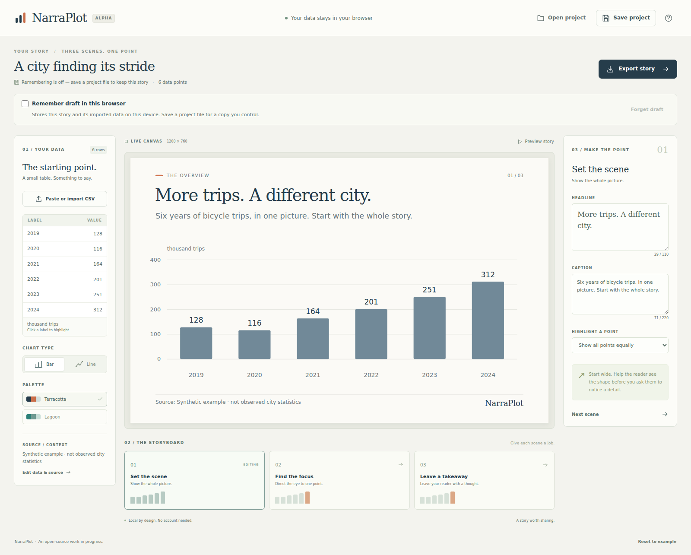

# NarraPlot

### A small table. A story worth sharing.

Turn a CSV into a three-scene visual story: set the context, focus the reader, and land the takeaway. Edit it in your browser, then take the result with you.

**Early alpha · Local data processing · MIT licensed**

<!-- The screenshot below is captured from the working editor, not a design mockup. -->


## Try it locally

Use Node.js 24 and npm:

```bash
git clone https://github.com/Berkopan/NarraPlot.git
cd NarraPlot
npm ci
npm run dev
```

Open the local address printed by Vite. A synthetic example is ready to edit; no account or API key is required.

## From table to story

1. **Bring a small table.** Paste CSV or open a file. Choose the separator, label column, value column, and number format explicitly.
2. **Give it a point.** Pick a bar or line chart. Edit the title, caption, and highlighted point for each of the three scenes.
3. **Take it with you.** Export a scene as SVG or PNG, download a portable HTML story, or save a project to continue editing later.

The preview and exports share the same SVG renderer. Switching scenes keeps the data, axis scale, and color meaning consistent.

## What works today

| Capability | Initial alpha |
| --- | --- |
| CSV import | Paste or file; comma, semicolon, or tab separators |
| Number mapping | Explicit decimal dot or decimal comma; labels stay text |
| Story editing | Exactly three scenes: overview, focus, takeaway |
| Chart types | Bar and line; one value series |
| Appearance | Two palettes, editable unit and source, optional attribution |
| Project files | Save and reopen a validated `.narraplot.json` file |
| Browser draft | Opt in to remembering; restore, discard, or forget the saved copy |
| Image export | Current scene as SVG or PNG |
| Story export | A self-contained HTML file with all three scenes |

The bundled example is **synthetic data**, not a claim about a real city.
Its [CSV, saved project, and portable HTML output](examples/README.md) are included
so you can inspect or reproduce the whole flow.

## Deliberate alpha limits

- **1–12 data points.** This first layout is for a compact, readable story. It does not silently sample a larger table.
- **One series and unique labels.** Duplicate labels are rejected; rows are never aggregated automatically.
- **Missing values stay missing.** Empty numeric cells produce a clear error, not a zero.
- **No grouping separators or currency/percent parsing.** Choose a decimal format and provide the numeric values; add the unit separately.
- **Line charts use row order and equal spacing.** Dates and numeric labels are not interpreted as a continuous time or numeric axis.
- **Updated data requires a review.** Existing scene annotations are marked for confirmation before those scenes can be exported.
- **MP4 export is not implemented.** A browser export feasibility study is the next major product decision. There is no placeholder video button.

Read [the data contract](docs/data-contract.md) for file limits and number behavior.

## Your data

NarraPlot has no application backend, analytics, or AI service. Import, editing, and export run in the browser. **Remembering is off by default.** Turn on “Remember draft in this browser” to save your story, including imported data, on this device. Your choice persists when browser storage is available.

On reopening, choose **Restore draft** or **Discard draft**. The saved copy stays untouched while that decision is pending; you can still edit and export the open story. Drafts from earlier alpha versions are offered for restoration without automatically opting you in. Invalid or unsupported drafts are also preserved until you discard them.

Turning remembering off stops updates but leaves an existing saved copy. **Forget draft** removes the saved copy, turns remembering off, and keeps your open story in the editor. Discarding a pending draft also turns remembering off. These actions affect only NarraPlot's own draft and preference keys. Storage failures are reported; a failed deletion is never presented as success. This alpha does not synchronize open tabs, so close other NarraPlot tabs before forgetting a draft if they might still be saving.

Browser storage can be cleared or unavailable; download a project file for a copy you control. A project file and a portable HTML export contain the data you put in them, so share those files with that in mind.

## Development

```bash
npm ci
npm run format:check
npm run typecheck
npm test
npm run build

# First browser-test setup on your machine
npx playwright install chromium
npm run test:browser
```

The production build is a static `dist/` directory. See [architecture and deployment](docs/architecture.md). Pull requests run the same build and browser checks in GitHub Actions.

Use `npm run format` to apply the repository's source formatting before a PR.

## Help make it useful

A small, reproducible improvement is welcome: a confusing import, a chart that loses meaning, an export that differs from the preview, or a keyboard path that gets stuck. Include a tiny synthetic dataset and explain the result you expected.

Start with [CONTRIBUTING.md](CONTRIBUTING.md). Product boundaries live in [the product brief](docs/product.md); instructions for coding assistants live in [AGENTS.md](AGENTS.md). Everything required to build and contribute is in this repository.

## License

[MIT](LICENSE).
